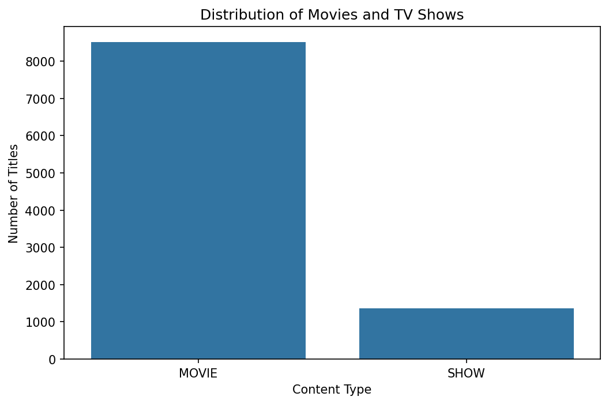
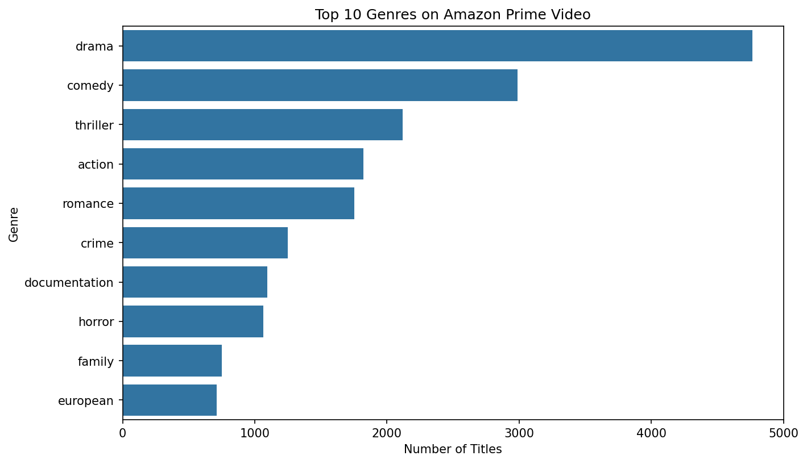
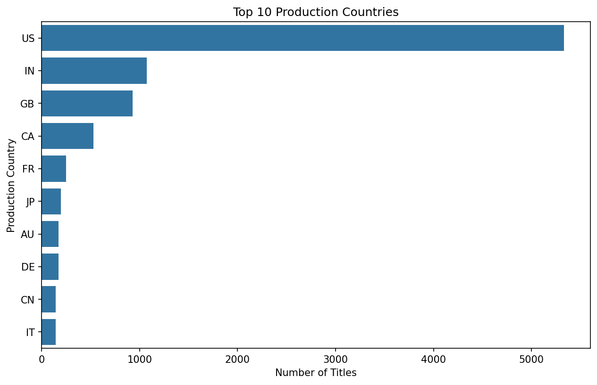
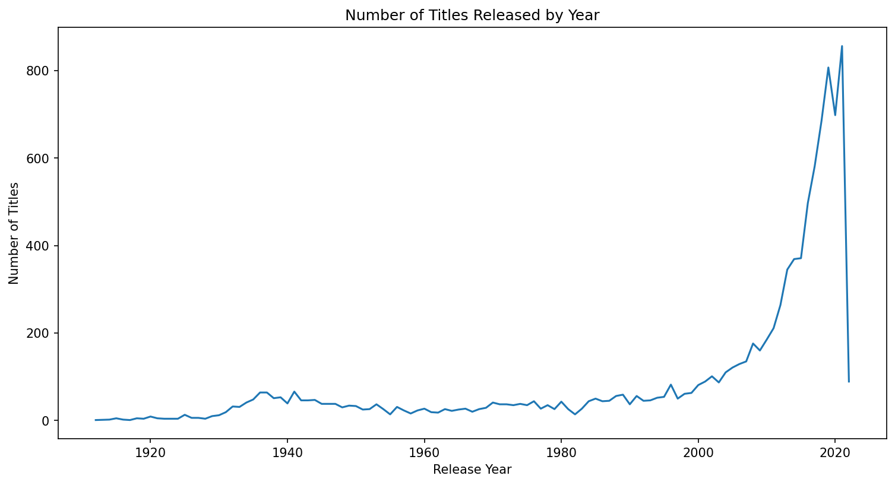
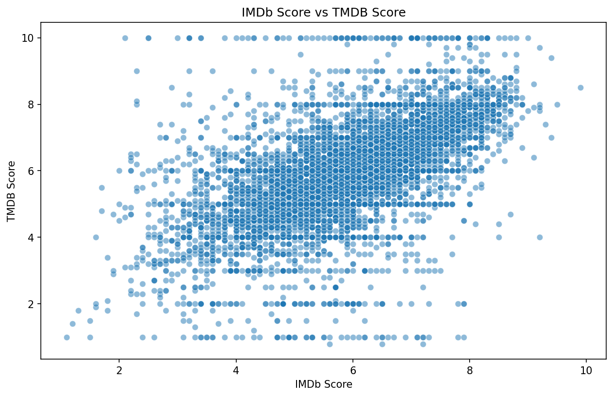
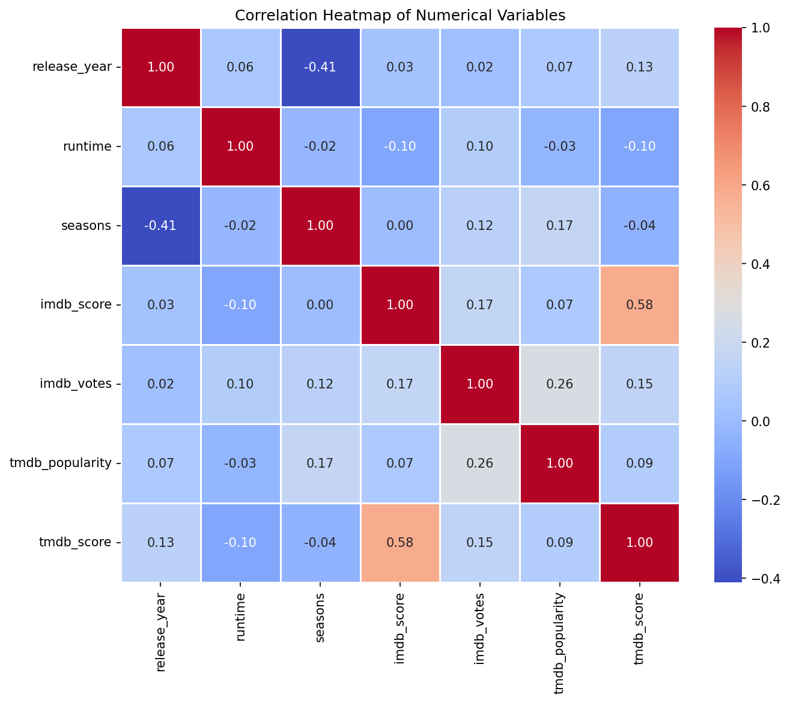

# Amazon Prime Video — Exploratory Data Analysis

An end-to-end Exploratory Data Analysis (EDA) project exploring Amazon Prime Video's content catalog using Python, Pandas, Matplotlib, and Seaborn.

The project investigates content types, genres, production countries, release trends, audience ratings, and relationships between numerical variables through data cleaning, analysis, and visualization.

## Project Overview

Streaming platforms need to understand their content libraries to make informed content and catalog decisions. This project explores a dataset of Amazon Prime Video titles to identify patterns, trends, and data quality issues.

The analysis uses two datasets:

- **Titles:** Movie and TV show metadata, including release year, genres, production countries, runtime, certification, and ratings.
- **Credits:** Actors and directors associated with titles.

## Objectives

- Compare the distribution of movies and TV shows.
- Identify the most common genres and production countries.
- Explore content release trends over time.
- Analyze IMDb and TMDB ratings and popularity.
- Investigate missing values, duplicates, and relationships between numerical variables.
- Communicate findings through clear visualizations.

## Tools & Technologies

- Python
- Pandas and NumPy
- Matplotlib and Seaborn
- Jupyter Notebook / Google Colab
- CSV datasets

## Dataset

The project uses the following files in the `datasets/` folder:

| File | Description |
|---|---|
| `titles.csv` | Content metadata for movies and TV shows |
| `credits.csv` | Actors and directors associated with titles |

**Data source:** AlmaBetter.

The analysis describes the available dataset; it does not measure actual streaming views or audience engagement.

## Featured Visualizations

### 1. Movies vs. TV Shows



Compares the number of movies and TV shows in the catalog.

### 2. Top Genres



Highlights the genres that appear most frequently. Titles with multiple genres may be counted in more than one category.

### 3. Production Countries



Shows the countries most represented in the dataset.

### 4. Release Trends



Explores how the number of titles varies by release year. Recent years may be incomplete in the source data.

### 5. IMDb vs. TMDB Ratings



Examines the relationship between IMDb and TMDB scores for titles with available ratings.

### 6. Correlation Heatmap



Summarizes relationships between numerical variables, helping identify patterns for further investigation.

## Key Findings

- **Movies dominate the catalog:** The dataset contains substantially more movies than TV shows.
- **Drama and Comedy are prominent genres:** These genres appear frequently in the catalog.
- **The United States is strongly represented:** India and the United Kingdom are also among the prominent production countries.
- **Release activity increases in more recent decades:** The final years should be interpreted cautiously because the dataset may be incomplete.
- **IMDb and TMDB scores tend to move together:** However, the two rating systems do not produce identical scores.
- **Metadata quality matters:** Missing certifications and other fields can affect comparisons and downstream analysis.

These findings describe the dataset analyzed in this project and should not be interpreted as measures of actual viewing behavior.

## Data Preparation & Analysis

The notebook includes:

- Data loading and inspection
- Data types, duplicate, and missing-value checks
- Analysis of catalog composition and release trends
- Genre and country analysis
- IMDb and TMDB rating comparisons
- Correlation analysis and visual exploration

The notebook contains additional visualizations beyond the six featured in this README.

## Repository Structure

```text
amazon-prime-video-python-eda/
├── README.md
├── requirements.txt
├── datasets/
│   ├── titles.csv
│   └── credits.csv
├── notebooks/
│   └── Amazon_Prime_Video_EDA.ipynb
└── screenshots/
    ├── 01_content_type.png
    ├── 02_top_genres.png
    ├── 03_production_countries.png
    ├── 04_release_trend.png
    ├── 05_imdb_vs_tmdb.png
    └── 14_correlation_heatmap.png
```

## How to Run the Project

### Option 1: Google Colab

1. Open `notebooks/Amazon_Prime_Video_EDA.ipynb` in Google Colab.
2. Upload `titles.csv` and `credits.csv`, or connect Google Drive and access the files there.
3. Ensure the notebook's CSV paths point to the correct locations.
4. Run the notebook cells from top to bottom.

## Author

**Vaibhav Deshmukh**

GitHub: [@vaibhavd8080](https://github.com/vaibhavd8080)

---

If you find this project useful, feel free to explore the notebook and its visualizations.
