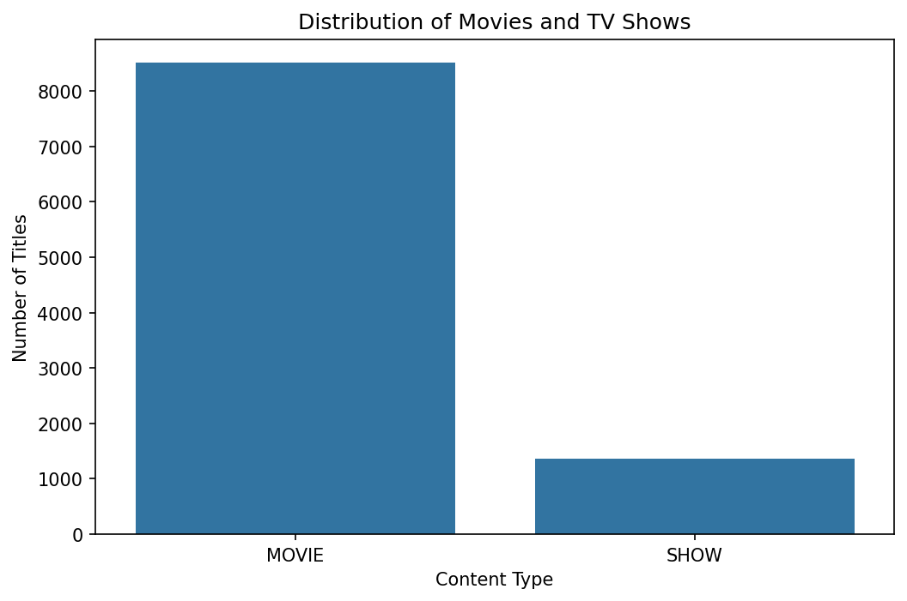
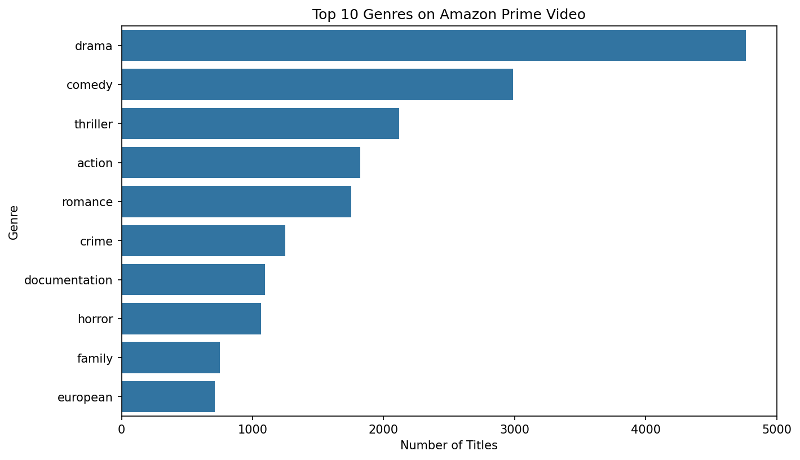
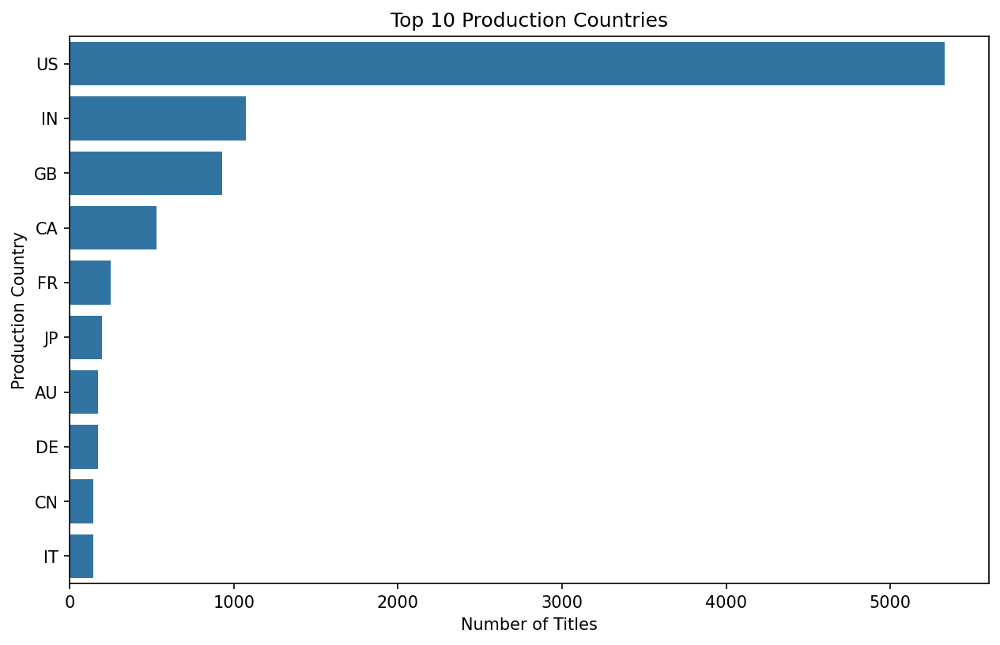
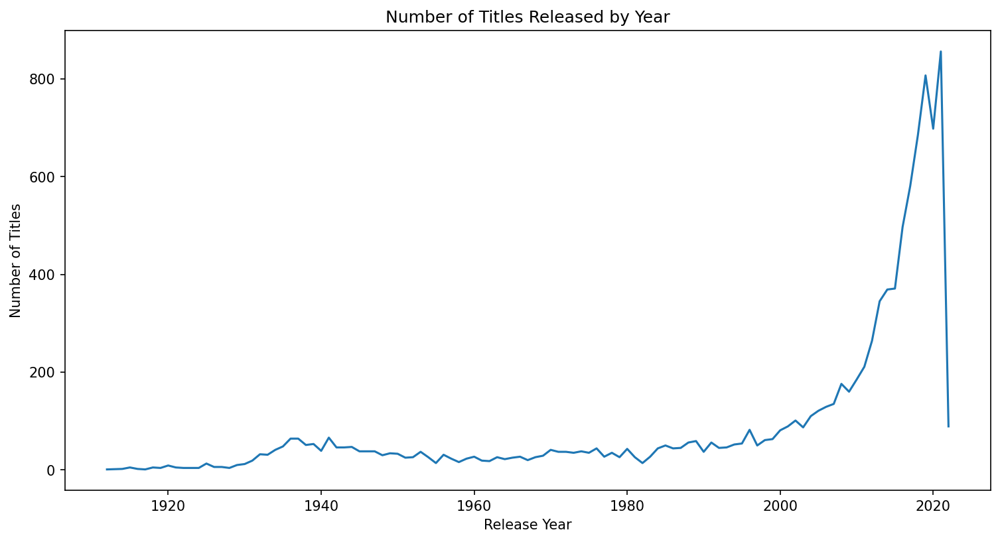
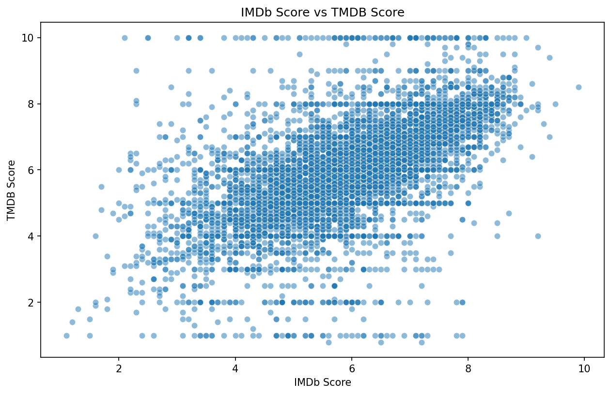
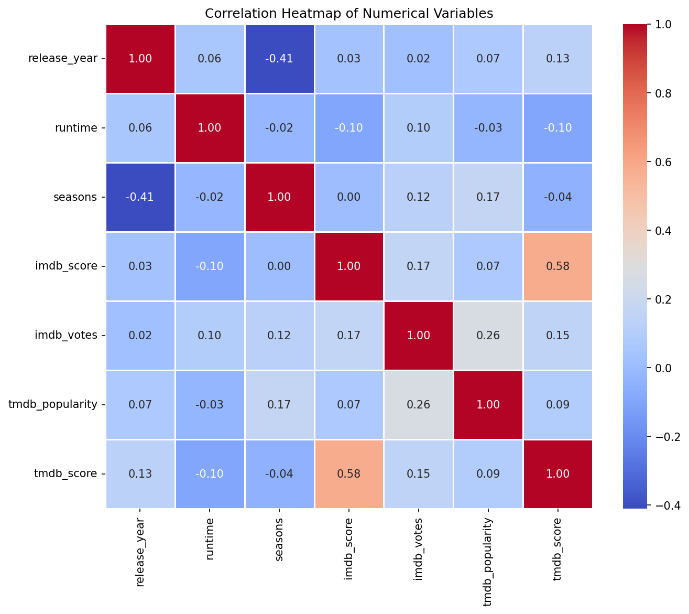

# Amazon Prime Video — Exploratory Data Analysis

An individual exploratory data analysis project using Python to examine an Amazon Prime Video catalogue dataset. The analysis explores content types, genres, production countries, release trends, ratings, popularity and available cast/director information.

## Project questions

- How are movies and TV shows distributed in the dataset?
- Which genres and production countries appear most frequently?
- How does the number of titles vary by release year?
- How do IMDb and TMDB ratings compare?
- What patterns appear in the numerical variables?
- Which actors and directors have the most credits in the available data?

## Featured visualisations

The following six screenshots are committed to this repository.

### 1. Movies and TV shows

### 2. Top genres

### 3. Production countries

### 4. Release trends

### 5. IMDb and TMDB ratings

### 6. Correlation heatmap

## Dataset

The repository contains two CSV files in the \`datasets/\` folder:

| File | Description |
|---|---|
| [titles.csv](datasets/titles.csv) | Title metadata, including type, release year, genres, countries, runtime and ratings |
| [credits.csv](datasets/credits.csv) | Actor and director credit records |

The existing project documentation attributes the dataset to AlmaBetter. A direct source-page URL and dataset licence are not currently recorded in this repository; those should be added if available.

This analysis describes the dataset provided for the project. It does not measure actual streaming views, watch time, subscriptions or audience engagement.

## Notebook

[Open the Amazon Prime Video EDA notebook](notebooks/Amazon%20Prime%20Video%20%E2%80%93%20Exploratory%20Data%20Analysis.ipynb)

The notebook covers data loading, inspection, data-quality checks, exploratory analysis and visualisation. It contains additional charts beyond the six selected for this README.

## Tools and libraries

- Python
- Pandas and NumPy
- Matplotlib and Seaborn
- Jupyter Notebook / Google Colab

Install the listed libraries with:

\`\`\`bash
pip install -r requirements.txt
\`\`\`

## How to run

1. Clone or download this repository.
2. Open the notebook linked above in Jupyter Notebook or Google Colab.
3. Make sure the notebook's input paths point to \`datasets/titles.csv\` and \`datasets/credits.csv\` (or to the corresponding uploaded files in Colab).
4. Run the notebook cells from top to bottom.
5. If a cell refers to a Colab-specific path such as \`/content/\`, upload the matching CSV file to the Colab session or update that path.

## Repository structure

- \`datasets/titles.csv\` — title metadata
- \`datasets/credits.csv\` — cast and director credits
- \`notebooks/Amazon Prime Video – Exploratory Data Analysis.ipynb\` — analysis notebook
- \`screenshots/\` — six selected visualisations
- \`requirements.txt\` — Python libraries

## Findings and interpretation

The notebook explores catalogue composition, genre and country frequency, release-year patterns, rating comparisons and numerical correlations. The screenshots provide visual examples of those analyses.

The README intentionally avoids publishing exact rankings or numerical conclusions that have not been independently checked against the saved notebook outputs. Recheck the notebook outputs before adding specific figures.

## Limitations

- The dataset is a snapshot and does not represent the current catalogue.
- Genre and country fields can contain multiple values per title; category counts may overlap.
- Missing values and incomplete recent-year records can affect comparisons.
- Ratings and popularity fields describe the available metadata, not actual viewing behaviour.
- The source attribution and licence need a direct citation in the repository.

## Author

**Vaibhav Deshmukh**  
[GitHub profile](https://github.com/vaibhavd8080)